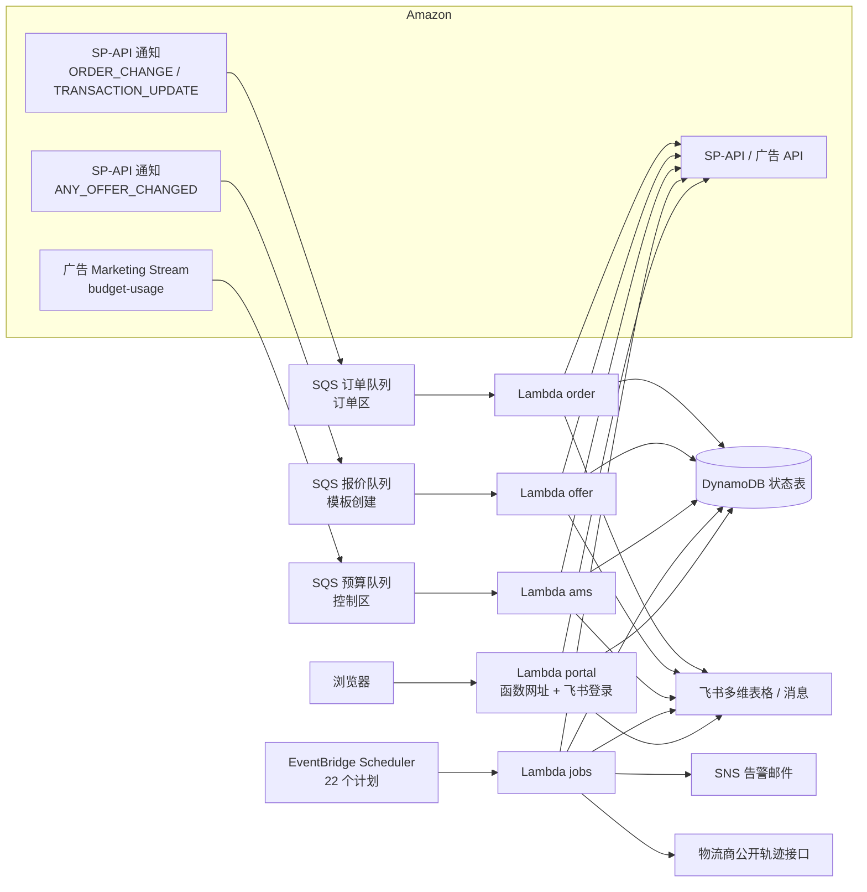

# AMZShop

亚马逊卖家运营自动化：一组跑在 AWS Lambda 上的 TypeScript 函数，把订单、财务、货件、库存、价格、广告、跟卖、竞品、邀评、报表和店铺健康这些日常运营工作，交给亚马逊推送和定时任务自动处理。业务数据写进飞书多维表格，需要人看的变化推送到飞书，另有一个只读的「店铺中台」网页。

> 这是一个美国站卖家自用系统的公开版本。店铺、商品、账号、密钥等私有信息和内部文档都已移除，测试里的品牌、商品、SKU、ASIN、订单号、货件号均为虚构。

## 文档

| 文档 | 内容 |
|---|---|
| 本页 | 能做什么、整体架构、目录结构、开发命令 |
| [docs/部署说明.md](docs/部署说明.md) | 准备清单、部署步骤、全部配置项 |
| [docs/使用与运维.md](docs/使用与运维.md) | 飞书消息、店铺中台、手动任务、告警与排障 |
| [docs/模块说明.md](docs/模块说明.md) | 每个模块的业务规则与不变量（代码注释引用的规则都在这里） |

## 能做什么

| 领域 | 任务 | 触发 | 做什么 |
|---|---|---|---|
| 订单 | `order` | SP-API `ORDER_CHANGE` 推送 | 订单与商品行写入飞书订单表（同一订单/SKU 更新原行，旧事件不覆盖新状态），新订单、取消即时提醒 |
| | `order-reconcile` | 每天 08:30 | 补漏：近 7 天新建、近 3 天更新、长期待处理的订单逐单刷新 |
| | `order-prices` | 每 30 分钟 | 用全部订单报告补写订单接口暂时给不了的「付款金额」 |
| | `order-reason` | 每 15 分钟 | 退货、取消、退款原因写回订单行（默认关闭） |
| 财务 | `finance` | 每天 08:30，`TRANSACTION_UPDATE` 推送唤醒 | 佣金、配送费、促销、逐笔退款、货件费用、其它资金流水（仓储费、库存赔偿等） |
| | `payouts` | 每天 09:30 | 放款与余额快照，放款发起、到账提醒 |
| 货件与库存 | `shipment` | 每天 08:00 | FBA / AWD 货件与明细同步，状态变化提醒 |
| | `forwarder-tracking` | 每小时第 50 分 | 头程物流商（纽酷国际、九方通逊、美设国际）的公开轨迹写入货件表；开船、到港、预约送仓、签收、到港推迟与异常提醒 |
| | `forwarder-backfill` | 手动 | 物流轨迹一次性回填（默认只读预览，不发消息） |
| | `inventory` | 每天 09:00 | 库存、销量、可售天数与断货预警 |
| | `inventory-health` | 每天 09:15 | 库龄、冗余库存、超龄附加费、低库存费提醒 |
| 价格 | `pricing` | 每小时 | 售价与促销活动同步到毛利润预估表 |
| 广告 | `ams` | 广告 Marketing Stream 预算推送 | 活动预算使用率写入广告预算表，超阈值提醒 |
| | `ads-early` / `ads-daily` | 每天 01:00（洛杉矶）/ 10:00 | 拉 SP 报表，写活动日报与每日总览，存每日分析快照 |
| | `ads-runaway` | 每日广告批次完成后 | 关键词“跑飞”（点击多、0 单）排查与提醒 |
| | `ads-review` / `ads-memory` | 手动 | 调价复盘数据包（只读）与调价记录写回 |
| | `ads-retention` | 每周日 05:00 | 月报核对无误后清理广告日记录 |
| 跟卖与竞品 | `offer` | SP-API `ANY_OFFER_CHANGED` 推送 | 跟卖出现/离开、购物车丢失/恢复提醒 |
| | `offer-reconcile` | 每小时 | 报价对账，补推送遗漏 |
| | `brand-watch` | 每天 10:40 | 搜索冒用本店品牌的他人 listing |
| | `buybox-watch` | 每小时 | 旧版 Buy Box 巡检（可关） |
| | `competitor-prices` | 每 2 小时 | 竞品比价（平时每天一轮，大促期间每轮），竞品清单每 7 天自动维护 |
| 运营 | `traffic-alert` | 每天 16:00 | 会话与转化率下降预警 |
| | `review` | 每 15 天（自动续排） | 自动邀评（美/加/墨，送达 5–25 天） |
| | `store-report` | 每天 00:15（洛杉矶） | 日报、周报、月报、年报推送与刷新 |
| | `store-health` | 每小时 | Listing 在售状态与问题、账户健康、高退货率处理费 |
| | `sqp` | 每天 11:30 | 搜索查询表现（SQP）周数据，供调广告参考 |
| 中台 | `portal` | 浏览器访问 | 只读店铺看板与报告页，飞书登录 |
| 维护 | `maintenance` | 每小时第 5 分 | 补发待发通知、重排中断的任务、健康检查，问题汇总成一封邮件 |

未注明时区的时间都是北京时间。对亚马逊的写操作只有两类：自动邀评发出的邀评请求，以及显式手动执行时创建或删除报价通知的目的地与订阅；其它全部是只读接口（含申请报告）。

## 架构



- **两个 CloudFormation 栈，一个模板**（`infra/template.yaml`，参数 `StackRole` 区分）：控制栈在控制区，含状态表、`jobs`/`ams`/`pricing`/`offer`/`portal` 函数、全部定时计划、报价队列与告警；订单栈在订单队列所在区，只含 `order` 函数、它的死信队列与告警。所有函数都读控制区的 SSM 参数和状态表。
- **配置与密钥**都在 SSM Parameter Store（`/amzshop/<环境>/`）：普通配置逐个参数，密钥合成一个 SecureString JSON「密钥包」，SKU 与 ASIN 的对应关系每个 SKU 一个参数。
- **运行状态**统一放一个 DynamoDB 表：事件去重、任务断点、租约、通知意图、健康记录、缓存与快照。
- **告警只走 SNS 邮件**：函数报错、死信队列有消息、队列积压、状态表写限流、Jobs 最终失败，以及维护任务的每小时健康汇总。

## 设计原则

完整规则见 [docs/模块说明.md](docs/模块说明.md)，这里是最重要的几条：

- **幂等**：推送和定时任务都按稳定业务键去重，重复、乱序、重放都安全；旧事件不覆盖新状态。
- **先落意图再写业务**：飞书消息的意图先存状态表，业务写完再发；发失败由维护任务补发（10 分钟后补，48 小时后过期）。
- **不猜数**：未知的金额、日期不用 0 或空值覆盖；取数失败保留旧值并标明原因。
- **断点续跑**：超出执行预算前保存断点，用一次性 Scheduler 计划按原任务身份续跑。
- **单店铺**：一套部署只服务一个卖家账号；推送里的卖家 ID 不是本店时不处理，最终进死信队列告警。
- **只用官方接口**：不抓取、不登录、不自动化任何亚马逊网页后台。

## 目录结构

```text
src/
  handlers/     Lambda 入口：order、ams、pricing、offer、jobs、portal
  business/     业务模块：订单、财务、货件、物流轨迹、库存、价格、广告、跟卖、竞品、邀评、报告、健康、维护
  clients/      亚马逊（LWA、SP-API、广告 API）、飞书 OpenAPI 与物流商轨迹接口的客户端
  portal/       店铺中台：登录、取数、页面
  report/       店铺报告的口径计算与页面
  config.ts     SSM 配置与密钥包读取（带实例内缓存）
  state.ts      DynamoDB 状态表封装（去重、租约、断点、通知）
infra/
  template.yaml               CloudFormation 模板（两个栈共用）
  deployer-policy.json        部署用 IAM 用户的权限策略（需替换账号 ID 等）
  source-queue-policies/      两条源队列的访问策略（需替换账号 ID、区域、队列名）
scripts/
  deploy.ps1      发布脚本（npm run deploy）
  cutover.ps1     审计、暂停自动入口、告警链路测试（Activate 阶段是早期迁移专用）
  set-secret.mts  往密钥包写入一个密钥（终端隐藏输入，不落盘）
  build.mjs、test.mjs           构建与测试
  verify-*.ps1、verify-*.mjs    在真实 AWS 上验收 SQS 部分失败、Scheduler、DynamoDB 条件写
tests/aws/        测试（内存版状态表、飞书、亚马逊，全部离线）
docs/             部署、使用与运维、模块规则
```

## 开发

需要 Node.js 24。

```bash
npm ci
npm run check    # 类型检查 + 全部测试 + 构建，发布前也会自动跑
```

单独运行：`npm run typecheck`、`npm test`、`npm run build`（输出到 `dist/<函数>/index.js`）。

约定：

- 不把密钥、令牌写进代码、日志、测试或命令行参数。
- 含中文的 `.ps1` 保存为 UTF-8 with BOM（Windows PowerShell 5.1 才能正确读取）；`infra/template.yaml` 只能是 ASCII。测试会检查这两条。
- 非平凡的业务逻辑配一条可运行的回归测试；测试不靠删掉金额、人工字段、去重、时区或消息确认边界来换取通过。
- 代码注释里的 “GAS” 指本项目早期的 Google Apps Script 版本。

## 已知限制

- 只支持单店铺、北美站点（以美国站为主，跟卖、邀评、Listing 健康覆盖加拿大、墨西哥）。
- 飞书多维表格的字段名必须与代码一致，部署前请对照 [docs/部署说明.md](docs/部署说明.md) 建表。
- 一些常量按原店铺的历史设定，需要按自己的情况调整，清单见 [docs/部署说明.md](docs/部署说明.md#需要按自己店铺调整的地方)。
- 物流轨迹只适配三家物流商网站背后的公开查询接口，这些接口不是正式 API，改版后会查询失败（不会写错数据），需要改 `src/clients/forwarders.ts` 的适配器；用别的物流商要自己加适配器。
- 发布脚本按 Windows PowerShell 5.1 编写和测试。
- 消息、页面和注释都是中文。

## 许可证

[MIT](LICENSE)
